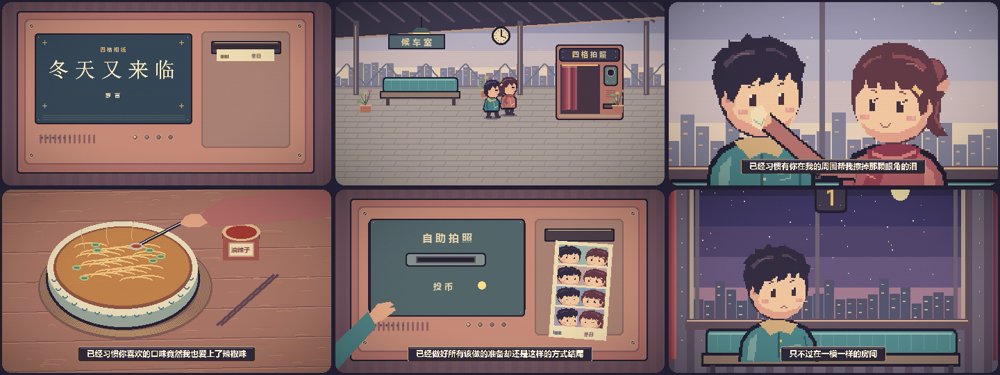

# 《四格相纸》从试片到整曲的制作复盘

每部新作开工先看这六帧。从左到右，上排是 00:01 的片名与出纸口、00:09 的车站环境、00:20 的双人擦泪；下排是 00:26 的面摊、00:42 的投币、00:54 重回拍贴亭时的空位。

用新歌的实际渲染入口做对应检查。片头让完整歌名长在一个能运作的物件上；环境全景先建立人物与地点的位置关系，道具特写画出材质、触点与状态变化。为人物近景单独画发块、眼睑、视线、嘴角和手势。按准备、接触、反应逐帧看，接触前后应能读出情绪差别。沿用清楚的像素边缘、成片尺寸合成的字幕与 30 fps 时间线。动作声贴住触点，重复的情感动作让同一音形有变化。整曲渲染前将新作的片头、人物近景和两个不同地点与图中对应景别并排检查，修好差异再扩片。

| 制作决定 | 本片的处理 | 下一次如何核查 |
|---|---|---|
| 立意落到一个习惯 | 从同版歌曲、发行文案和热评读出冬天重来、陪伴变成独处。用“两个人曾经怎么拍照，今年怎样再拍一次”组织人物行动。 | 能指出哪些是有来源的背景、哪些是听众解读、哪些是原创桥段。见[研究流程](research-and-story.md)。 |
| 前奏值得看 | 拍贴机铭牌在第一帧给出完整歌名，旁边的取相口慢慢吐出双人照。观众在等相纸上的人显出来。 | 按常速看第一帧到第一次行动。缩到手机尺寸仍能读全片名，并能看见另一个正在发生的事件。 |
| 人物好看且能表演 | 近景以短圆脸、发块和眼形识别人，双人同框时相互对视。方巾抵达眼角后男生才闭眼；后来同样的动作由他自己完成。 | 审同一人的远景、双人近景、道具照片。再看手从谁的肩出发，触点处是否遮住泪珠，收手后脸上留下什么变化。见[角色和场景美术](pixel-game-visuals.md)。 |
| 场景回访有新意 | 先让两人挤进镜头，再回到同机位看他身边的空位。后半首把相纸带离机器，放进相册、靠近剪刀、用胶带修好，尾奏收进信封。 | 隐去歌词，并排看两次副歌。能指出第二次谁作了不同的选择，以及这个选择改变了哪件东西。 |
| 像素清楚，镜头连贯 | 场景按像素网格绘制，标题和演唱字幕在交付尺寸合成。按同曲参考实测的 30 fps 输出，让人物在接触处停留，倒数和快门继续按同一时钟走。 | 看编码后字幕笔画、转场两侧和接触前后的连续帧。为其他参考片重新测帧率。 |
| 延长已认可的试片 | 沿用前一分钟的画面，用同一套角色、相纸、台词排版续写。第二段副歌加上本人修复旧照的行动，尾奏给相纸一个去处。 | 在试片与整曲的接缝核对末帧、首帧、歌词、音乐源偏移和道具状态。只改声音时可直接复用视频流，并比对视频流哈希。 |
| 声音有作品自己的记忆点 | 机械声解释机器动作，上行双音连接情感动作。初次擦泪和后来自己擦泪沿用音程，改变音区与衰减；握手时再补一个收束音。 | 先听声音能否认出倒数、快门、出纸，再带音乐听双音是否仍可辨；看动作时检查提示响在触点。见[音色与可听度](sfx-and-beat.md#给同一部作品设计成套提示音)。 |

**交付顺序。** 保存原曲、独立音效和混音母带；从交付 MP4 解码验证关键声音。相册翻页、倒数和快门都可反复使用；为每次复用写下动作或情绪上的理由。将音轨数字检查、实际播放和用户回听分别记录，整曲验收覆盖最后的尾奏。

## 整曲后段和动作对照

- [后半曲接触表](four-frame-photo-sequel.jpg) 展示相册、剪刀、站台、围巾、录音机、信封到离开车站。记忆、动作近景和环境远景交替，回到车站时同伴、照片用途和人物决定已经变化。只借用远近交替、材料光线和回访方法，另画本曲人物、地标和道具。
- [擦泪连续帧](four-frame-photo-contact.jpg) 可看到方巾与眼角接触时，眼睑和嘴形跟着情绪变化。使用类似近景时另核手腕、肘和道具遮挡，坐姿或全身镜头再核承重。
- 片头到开唱拿歌名、第一次出纸和第一句入镜分别对照；首次擦泪、独处和握手保留同系列音形，音区、和声及声像随关系改变。逐镜自查和用户确认格式见[静帧确认与逐镜审片](production-review.md)。
