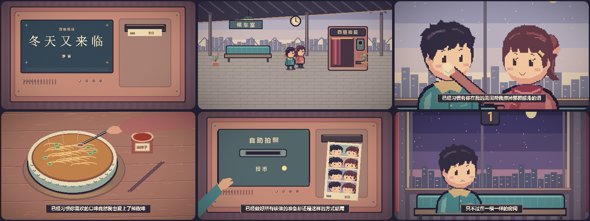

# 制作案例

[四格相纸](#四格相纸) · [普通朋友与生活 RPG](#普通朋友与生活-rpg) · [麦恩莉与街机双人叙事](#麦恩莉与街机双人叙事) · [教程样本](#教程样本和取证范围)

## 四格相纸

这六帧用于复盘本片和核对采用同款画风的项目。从左到右，上排是 00:01 的片名与出纸口、00:09 的车站环境、00:20 的双人擦泪；下排是 00:26 的面摊、00:42 的投币、00:54 重回拍贴亭时的空位。



用新歌的实际渲染入口做对应检查。片头让完整歌名长在一个能运作的物件上；环境全景先建立人物与地点的位置关系，道具特写画出材质、触点与状态变化。为人物近景单独画发块、眼睑、视线、嘴角和手势。按准备、接触、反应逐帧看，接触前后应能读出情绪差别。本片用清楚的像素边缘、成片尺寸合成的字幕与 30 fps 时间线。动作声贴住触点，重复的情感动作让同一音形有变化。使用这个案例作为视觉基准时，整曲渲染前将本项目的片头、人物近景和两个不同地点与图中对应景别并排检查，修好差异再扩片。

| 制作决定 | 本片的处理 | 下一次如何核查 |
|---|---|---|
| 立意落到一个习惯 | 从同版歌曲、发行文案和热评读出冬天重来、陪伴变成独处。用“两个人曾经怎么拍照，今年怎样再拍一次”组织人物行动。 | 能指出哪些是有来源的背景、哪些是听众解读、哪些是原创桥段。见研究流程。 |
| 前奏值得看 | 拍贴机铭牌在第一帧给出完整歌名，旁边的取相口慢慢吐出双人照。观众在等相纸上的人显出来。 | 按常速看第一帧到第一次行动。缩到手机尺寸仍能读全片名，并能看见另一个正在发生的事件。 |
| 人物好看且能表演 | 近景以短圆脸、发块和眼形识别人，双人同框时相互对视。方巾抵达眼角后男生才闭眼；后来同样的动作由他自己完成。 | 审同一人的远景、双人近景、道具照片。再看手从谁的肩出发，触点处是否遮住泪珠，收手后脸上留下什么变化。见角色和场景美术。 |
| 场景回访有新意 | 先让两人挤进镜头，再回到同机位看他身边的空位。后半首把相纸带离机器，放进相册、靠近剪刀、用胶带修好，尾奏收进信封。 | 隐去歌词，并排看两次副歌。能指出第二次谁作了不同的选择，以及这个选择改变了哪件东西。 |
| 像素清楚，镜头连贯 | 场景按像素网格绘制，标题和演唱字幕在交付尺寸合成。按同曲参考实测的 30 fps 输出，让人物在接触处停留，倒数和快门继续按同一时钟走。 | 看编码后字幕笔画、转场两侧和接触前后的连续帧。为其他参考片重新测帧率。 |
| 延长已认可的试片 | 沿用前一分钟的画面，用同一套角色、相纸、台词排版续写。第二段副歌加上本人修复旧照的行动，尾奏给相纸一个去处。 | 在试片与整曲的接缝核对末帧、首帧、歌词、音乐源偏移和道具状态。只改声音时可直接复用视频流，并比对视频流哈希。 |
| 声音有作品自己的记忆点 | 机械声解释机器动作，上行双音连接情感动作。初次擦泪和后来自己擦泪沿用音程，改变音区与衰减；握手时再补一个收束音。 | 先听声音能否认出倒数、快门、出纸，再带音乐听双音是否仍可辨；看动作时检查提示响在触点。见音色与可听度。 |

**交付顺序。** 保存原曲、独立音效和混音母带；从交付 MP4 解码验证关键声音。相册翻页、倒数和快门都可反复使用；为每次复用写下动作或情绪上的理由。将音轨数字检查、实际播放和用户回听分别记录，整曲验收覆盖最后的尾奏。

### 整曲后段和动作对照

- [后半曲接触表](four-frame-photo-sequel.jpg) 展示相册、剪刀、站台、围巾、录音机、信封到离开车站。记忆、动作近景和环境远景交替，回到车站时同伴、照片用途和人物决定已经变化。只借用远近交替、材料光线和回访方法，另画本曲人物、地标和道具。
- [擦泪连续帧](four-frame-photo-contact.jpg) 可看到方巾与眼角接触时，眼睑和嘴形跟着情绪变化。使用类似近景时另核手腕、肘和道具遮挡，坐姿或全身镜头再核承重。
- 片头到开唱拿歌名、第一次出纸和第一句入镜分别对照；首次擦泪、独处和握手保留同系列音形，音区、和声及声像随关系改变。逐镜自查和用户确认格式见静帧确认与逐镜审片。

## 普通朋友与生活 RPG

用户要这条参考的像素 MV 时，先将下列约定放进项目的风格表，再用本项目的人物、歌词、地点和行动实现。取证范围与时段见本地参考记录。本配置的外观依据是片头至约 01:06 的游戏演出。

| 片中画面 | 制作约定 | 抽帧时看什么 |
|---|---|---|
| 片头云、远山、林线、草地与菜单 | 在固定横屏画幅上分层画景，标题留天空负空间。菜单确认后进入与第一句有关的行动，按歌曲前奏决定菜单时长。 | 选中反馈是否确实引出下一个地点。 |
| 00:26 日间田地 | 俯视地面，房屋保留正面立面；路面连到门口，用栅栏、作物和树冠分区。人物约占画高一成，脚底贴地。用草绿、赭木、土路三组中间色，花点和作物成簇布置。 | 缩小画面还能找到人物、朝向和要互动的地块。 |
| 00:26 与 00:42 对白 | 底部居中，两块相邻木框，左文右像；用深棕外线、赭色内线、金色高光和麦黄色纸面。地图用小人，右框另画同一人物正面胸像。句子按真实句起出现，需要逐字效果时采用已有词时点。 | 木框避开脚底、手部接触和头顶气泡；晴天、夜雨都能读。 |
| 日间 HUD、关系清单与雨街 | 右上时间/天气、其下读数和右侧窄条各用一项有意义的状态。关系页只在人物关系发生变化时出现，回到街道后继承结果。固定地标与相机朝向，雨线、路色和灯光改变气氛。 | 除掉文字还能认出回访的地点；读数变化之前看得见原因。 |
| 暗场探索、海面栈桥与尾转场 | 暗场保留人物轮廓、行动目标的亮度；海面留大块蓝色负空间，栈桥把视线引向尽头。需要章节收束时，用网格遮罩从同一时钟退出。 | 探索结果在水边得到回应；转场结束没有多占音乐时间。 |

#### 用原比例起稿，再适配字幕

在 672×378 抽帧上，00:26 的左框横跨约 x=106–452、人物框约 x=458–565。00:42 左框大体同宽，高度由约 120 像素收成约 73 像素。新项目可按宽度 16% 至 84% 起稿，把整体上移至目标平台安全区，先画地图角色与关键动作，再决定框高。纸面深色字与木框共用同一光源。外框缩放用整数像素，文字字号以目标尺寸的实测阅读为准。

Pillow 工程可把 [rpg_dialogue.py](../assets/examples/rpg_dialogue.py) 复制到项目，在每帧世界、角色和头顶反馈画好后调用。传入由歌曲时间线选中的歌词；原创对白占同一位置时与歌词错时或分区。用此函数烧过歌词的导出路径只合音频，避免叠第二层歌词。保留独立 SRT 可供编辑。使用已有 Node、Canvas 或 Remotion 工程时直接沿用原渲染入口，按上表实现布局。

~~~python
from rpg_dialogue import draw_dialogue

# frame 是本时刻重新绘制的虚拟画布。font 与 portrait 由项目加载。
occupied = draw_dialogue(frame, active_lyric, font, portrait=speaker_portrait,
                         expanded=long_dialogue)
~~~

返回值为虚拟画布的 (x, y, width, height) 遮挡区。将它与当前镜头需要看清的手部、道具和脚底区域比较；相交时先调整主体站位或框高，再抽同一帧。字幕超长时扩大框或按句义分页。空句在新画布上返回空区域。

#### 用四条教程推进同一首歌

| 参考与取向 | 写进当前项目的决定 | 进入下一段前的检查 |
|---|---|---|
| 桃泯，约 01:32–02:20、03:58 起：人物、木屋、码头和任务组成连续地点 | 为主角画一条能走通的路线，给每个场景写入口、目标物、可见动作和离开时带走的状态。 | 从上镜离开的方向、携带的物件、已完成的任务在下镜能接上。 |
| 天线短路宝宝，约 01:21–02:40、02:41 起：屋顶与电话亭用倒计时和回应组织戏剧 | 为重复副歌各写一个不同结果；将“等待”落实为角色主动做的事。先检查最拥挤的一帧、一次手部接触和一次场景交接，再扩到其余段落。 | 同一歌词再次出现时，即使隐去歌词，也能辨出新的结果。 |
| 10559… 节奏教程：从音频波形、速度到画面落点 | 给最重要的动作分别标准备帧、接触帧和余韵。把原曲局部起音与接触帧排在同一时间轴，按同步候选图记录候选和人工确认。低置信区按乐句和叙事时长安排。 | 确认动作到位且可读后再调剪点。112.8 BPM 是教程中出现的数字，每一首新歌都需重新分析。 |
| 1bf664… 制作教程，约 01:05–03:45：歌曲地图、听感、同内容比稿、逐段制作 | 同一动作比较两种镜位或明暗；把具体词落实到动作，把抽象句落实到距离、天气、色温或停顿。音乐最强处只选一个能改变故事的事件。 | 在静态接触表检查遮挡和越界，对动作与转场查看连续帧；按镜头 ID 记录问题并重查原时段。 |

记录实际采用的选择，例如「第二次副歌，送出信件后收件栏从空变成已签收；手与信封接触后才更新」。不同歌曲可以用不同状态、地点和色调。角色建模、主题归纳、字幕来源与试听状态仍按主流程记录。

## 麦恩莉与街机双人叙事

适用于以关系变化为主线的像素 MV。先决定玩家代表谁、现实里是谁在做什么，再选关卡、色板和游戏反馈。单人叙事也可借用道具回访和动作接剪。

### 参考片取证

用户提供的 55e1383ffcf185cfe78c1feed338e7b6.mp4，片内题名《麦恩莉》，长 291.17 秒。原画面 960×544、30 fps。以三秒间隔浏览全片，并逐帧扫描低分辨率游戏区域的变化，在选定切点附近检查连续画面。下列时码用于回看，秒级段界为近似。字幕给出歌词线索，音频振幅辅助定位；创作过程、精确鼓点与人物原型均无法从这些测量确认。

| 区间 | 可见的构造 | 怎样使歌词与关系互相解释 |
|---|---|---|
| 约 00:00–00:26 | 标题的单人开始提示，雨街与机厅，第二玩家的加入提示，孤舟，投币手部特写 | 先把孤独安排为可见的空位和单人行动；第二个人有一次明确的加入动作。现实街机也是进入幻想的物件。 |
| 约 00:26–01:12 | 双人战斗、雨云敌人、撑伞、K.O.；进入明亮横版，两人同行、跨平台、指尖相触、升级、过关 | 抽象的难处占据两人共同面对的位置；状态变化发生在协作之后。“指尖”落到手的特写，随后才放宽到两人前进的全身。游戏生命和分数位于上方，歌词另居下方。 |
| 约 01:12–02:40 | 明亮关卡退回霓虹街面；同一街口有单人和双人版本。低饱和住处、拍照四格、街市、时钟、雨伞和水边交替出现 | 歌词回望从前时，同一人物暂时独处；关系改变由谁出现在原地、谁为谁撑伞、日子如何过去来说明。再次唱相近句时，镜头从游戏中的保护转为生活里的陪伴。 |
| 约 02:40–03:45 | 漩涡里小船受困与解脱；抽象处境变成转轮；游乐园入口转为全景，舞池继而变成过山车和回环 | 每段只选一种动作比喻。遇到难处会改变路线、姿势和速度；情感释放时镜头扩大、运动幅度增加，主角仍能从发型、服装和并肩站位辨认。 |
| 约 03:45–04:51 | 摩天轮外景与座舱内景交替；暂停界面、手部特写、烟花、游乐园全景；两人回到街道与续关界面 | 由远及近把注意力从游乐设施交回关系。片尾用双人续关回答开场的单人开始。结局在游戏状态和现实行动上都可见。 |

### 剪辑台上的具体取舍

- **结果接下一关。** 约 00:35.20 仍见 K.O.，00:35.30 已明显提亮，约 00:35.70 可读新关卡。安排时把「上一事件何时完成」「新空间何时可读」分别落到时间线上；让歌词面板在亮场仍可读。
- **动作连续的硬切。** 00:50.83 人物还在伞下，00:50.87 已换横版地形；人物组合与底部歌词位置延续。切换前后可让朝向、运动方向、道具轮廓或屏幕位置中的一项相接。
- **同词换景别。** 约 00:54–00:59 的手部镜头与约 04:06 的手部再现共同承接指尖意象。第一次交代接触，第二次应新增关系信息。可先在工作表上并排看两次副歌的同一句。
- **进出想象与回忆。** 01:36.97 硬切入冷色室内；02:43.00 左右由水边进入漩涡。前者让独处落到现实地点，后者把歌词困境转成画面运动。选择转场时先说明时间、地点或心理层面有何改变。
- **高潮与收束。** 03:24.10 的高亮帧发生在舞池动作中；04:10.30 附近的提亮从座舱走向全景；04:30.53 回到机台续关。闪白在这几处承担不同功能。实际制作可用局部光、视线接剪或灯箱变亮实现同一交接，强度跟新歌重定。
- **节奏证据。** 相邻段落有数秒一变和持续十余秒的构图。画面差检测也会命中闪烁、缩放和灯效；逐点回看后再把它列作切镜。若未试听，只记录字幕句界、候选瞬态及实际帧，保留 draft。

**一次可复算的音画抽查。** 在这份文件上，将单声道音频降至 8 kHz，以 256 样本 Hann 窗、80 样本步长检测正向对数频谱变化，再和帧差切点相比。00:42.733、00:46.800、00:50.867 三次画面变化各相隔约 4.07 秒，最近的候选起音分别早 47、44、41 毫秒。02:43.000 的最近候选晚 16 毫秒，04:10.300 提亮处则早 154 毫秒。这支持把「一组连续动作沿相近节奏推进」与「转场给情绪留时间」分别处理。结果依赖检测参数，不代表每处都是鼓点或作者刻意设置了这一偏移。

### 应用到新歌

先读主题与可读性，将内容分为公开可核的创作背景、歌词支持的关系、项目原创情节。例如，录音确实采样一首旧歌，可以自编“用录音保存城市声音”的故事；不能据此断言歌手亲历片中告别。项目笔记记来源、允许的推断和对应镜头。

按真实歌词建立下面的对照。可放在已有分镜备注，无需改动 schema。

| 歌词或句 ID | 当下现实行动 | 游戏中可见的状态变化 | 触发帧与接剪条件 | 下一次回访新增什么 |
|---|---|---|---|---|
| 具体动作 | 谁伸手、握住哪一物件 | 所持物换主人 | 接触后才显示获得，下一镜接同一只手 | 重现时原持有人已离开 |
| 抽象的分离 | 通话中断，一人继续前进 | 双人声道只余一路 | 灯灭后留出反应，再切空位 | 同一空位传回另一人的声音 |
| 段落中无歌词 | 走完前一动作的后果 | 保持刚取得的状态 | 留足读图时间后才开新任务 | 回到起点时状态已经改变 |

选一个全片都会返回的地点或物件，给它设计独处、共同经历和结局三种状态。具象词可用局部特写，抽象段可转成障碍、合作动作或运动轨迹。现实、记忆、关卡可以有不同色域，人物与道具锚点贯穿。独立检查两个复唱段、一个真实硬切和一个跨世界过渡；并排观察末帧与首帧，再连播确认动作时长。分镜或出片仍遵循原曲的歌词时轴、角色接触检查和项目安全区。

## 目标风格落地

以《普通朋友》成片效果为目标时，先读像素 RPG 文字制作案例，写全片风格表，再把标题、角色、地图、对话 UI 和状态变化编排成同一段游戏演出。该案例是文字制作指南，不附带视频样片：

| 参考片区间 | 可见组织方式 | 转为本项目时的检查点 |
|---|---|---|
| 00:00–00:18 | 蓝天、云鸟、远山、松树和草地构成标题场景；主副标题与菜单出现，选择反馈进入地图。 | 标题层级清楚，菜单动作导致可见的场景转入，标题牌不承担后续全部叙事。 |
| 00:19–00:32 | 俯视宅地和街道；固定头像、暖色木框与对话面板持续组织人物互动。 | 角色身份、场景方位、对白和人物行为保持对应，阅读面板不遮挡关键动作。 |
| 00:33–00:48 | 关系清单显示头像/心形状态，同一街景转为夜雨。 | UI 状态和天气变化服务于关系段落；回到旧地点时用光线、天气或行动显示时间/情绪变化。 |
| 00:49–00:58 | 暗场探索搭配递增计数、双竖条状态和对话。 | 数值更新只在分镜中有对应事件时发生，变化后的状态延续到相关后续镜头。 |
| 00:59–01:06 | 人物来到海边栈桥垂钓，沿用对白与竖条状态，以菱格转场退出。 | 结尾场景回应前面的关系与状态线索，转场保留动作和字幕阅读时间。 |

这段成片的目标效果来自**游戏系统与故事共用一条状态时间线**：标题/菜单负责入场，地图负责地点与段落，头像/对话框承载人物交流，关系图标、计数、资源和状态条只显示与情节相关的信息。每次 UI 变化都写明由哪个动作或事件触发，以及后续哪个镜头承接。可借用这些界面职责，不照抄角色、文本、具体摆位或素材。

像素技术建议仍按项目目标确定：固定内部网格与整数放大，最近邻保持硬边。参考片在 1920×1080 横画幅播放；不能由成片反推出作者内部网格、生成模型或导出工程。标题可用天空、远山、树列、草地等景深层次，使用明显的字面/描边对比与木牌副标题；之后让原创地图、角色行动和天气延续相同的像素簇尺度、色板及轮廓粗细。

样片可选。仅交方案或分镜时用角色卡、动作条、静帧和状态连续性完成阶段检查。用户确认场景和人物静帧后，如有需求或需核动作、转场、字幕，再制作动态样片。若验收目标是完整动态成片，再按其实际交付范围检查关键帧、角色动作、对话/UI 可读性、转场和音画证据；不把 1 fps 抽帧或 ASR 当作精确卡点证明。

故事、角色、歌词、标题字形和具体场景按当前歌曲原创；参考片提供画面组织方法与像素质感，不代替本项目的叙事设计。取证事实及浏览限制见取证记录。

下面每轮只发当前阶段的提示词，替换括号内容为真实路径/参数。逐阶段自检，先把本项目实际静帧交给用户分别确认场景和人物。确认记录覆盖拟制作的范围，再进入任何动态制作。

## 教程样本和取证范围

#### 用户提供的抖音参考视频

作品：《AI手搓音乐MV，像素氛围感直接拉满 我用 DeepSeek 做了一支音乐动画 MV！附制作思路》；作者：拓扑同学；页面发布时间：2026-11-09 19:04；视频 ID：`7706125819504053514`；来源：

```text
https://www.douyin.com/video/7706125819504053514
```

2026-11-22 读取页面时，播放器显示时长 1:47，页面标注“作者声明：内容由 AI 生成”，并提供平台章节摘要。浏览器提示当前静音，因此未试听或核听旁白、歌曲、歌词时点和节拍。

页面章节摘要将内容分为引言（00:06）、歌词画面匹配（00:19）、画面风格与镜头衔接（00:36）、逐词字幕（01:17）和结语（01:38）。摘要还提到 DeepSeek V4.1 Flash；这些信息属于平台自动摘要，只用作导航线索，未经对应画面、音轨或作者材料核实，不写成作者原话或已验证步骤。

抽样画面记录：约 00:38 可见月亮像素特写、颜色选项“淡蓝”“紫色”及歌词文字；约 00:49 可见分格像素画面和“还要考虑镜头之间怎么衔接”的屏幕文字；约 01:40 可见多格像素场景与“你不用”“不说”“稳稳地接住你”等歌词片段。以上只记录当时可见内容，不据此推断完整提示词或渲染实现。取证分类与记录格式见 参考片取证记录。

对本技能可迁移的启发是把歌词意象落到具体画面、提前检查相邻镜头的衔接，并让重复歌词带来有意义的画面变化。当前流程已经覆盖这些做法。逐词字幕可作为可选表达，只有实际逐词时点得到核对时才称为同步；页面摘要本身不足以把它设成默认要求。

方法参考：桃泯《用 Ai 做像素风音乐 MV》，抖音视频 ID `7704949269866914043`。页面显示发布于 2026-11-06 14:58，核对日期 2026-11-18。来源地址：

```text
https://www.douyin.com/video/7704949269866914043
```

本轮用户提供的 A 文件为 816×544、30 fps、275.667 秒，并有音轨；按 1 fps 抽取 276 帧覆盖全片，另放大检查提示词与代表画面。完整时间区间及讲解/成片分段见 参考片取证记录。这是全时间线的逐秒视觉检查；音轨只完成全长 ASR 草稿阅读，未人工听辨或验收精确音画同步。

| 教程时间段（约） | 可见操作 | 可迁移的方法 |
|---|---|---|
| 00:29–01:31 | 展示歌曲分析提示词与结构化结果 | 先拆实际段落、歌词、情绪及时间候选，再进入画面设计 |
| 01:32–02:20 | 展示游戏化故事、角色、场景与两张静帧方案 | 先定叙事与美术方向，比较代表静帧后再推进镜头 |
| 02:21–03:57 | 展示歌词/镜头规划、可选短片段预览及扩片要求 | 有动态风险时用短片段检查角色、光色、空间、动作和字幕；样片按用户范围选择 |
| 03:58–04:35 | 展示《天空之外》像素 RPG 成片片段 | 人物行动、道具、任务状态和歌词面板共同推进结果 |

教程播放器及结果说明显示制作范围约 **37.30 秒**，并非原歌曲全长。两张静帧的结果说明给出 `480×270` 内部画布与四倍最近邻放大；这些是作者界面的报告，不能充当我们新项目的验收结果。未看见可确认的模型名称或渲染源码，记录为未知。下文提示词与工程约定是改进建议，不是作者原文，也不保证相同耗时或画质。

#### 本地教程 1bf6641d938b66d01c407e360efd03cd.mp4

该片时长 269.366 秒、1920×1080、AAC 双声道。全片按 3 秒间隔抽帧生成 90 格接触表；完整音轨读过本地 Whisper 转录草稿。接触表覆盖全片结构，但不等于看过每个原始帧或逐秒播放；ASR 只用于导航，可能错词/错时码。精确歌词、歌曲情绪与卡点仍以人工听辨或用户提供记录为准。区间细节见参考片取证记录。

| 视频时间（约） | 教程所示内容 | 在 Skill 中的应用 |
|---|---|---|
| 00:35–01:05 | 说明使用代码逐帧生成，再跟音乐剪接 | 分开规划画面实现和音频时间线，不把音乐理解能力当成默认前提 |
| 01:05–02:04 | 展示歌曲/歌词与段落分析，随后建议补一份听感笔记 | 把能量、BPM 等机器线索与歌曲情绪感受分开写；听感笔记用简单语言即可 |
| 02:04–02:29 | 比较三张视觉方案图并选择方向 | 同一段内容的三张静帧供未定风格时选择；用户已确定像素方向，就只比较像素内部的构图/色彩 |
| 02:30–03:45 | 用字面画面、抽象情绪、能量强弱和单镜规则设计分镜，再按段落制作 | 具体词转为可见主体/动作，抽象句用色彩/天气/表情等表达；最高能量处安排全片最强事件，一镜一个主视觉重点 |
| 03:45–04:24 | 每秒抽帧检查遮挡/越界，按问题修改镜头；末尾提醒音乐授权 | 接触表先做静态扫查，动作和转场另做密集检查；只返修有问题的段落，并保留授权记录 |

样片是像素城市小人持续旅行，跨越屋顶、城市和水边，随天气/时段变化保持人物和视觉语言连贯。视频开头用于讲解的黑底与荧光强调色属于教程版式，不作为 MV 的美术风格。借用的是“连贯像素旅程、歌词与情绪分开规划、先静帧定方向、分段制作和逐段返修”的方法；不照搬具体人物、对白、路线或烟花高潮。
